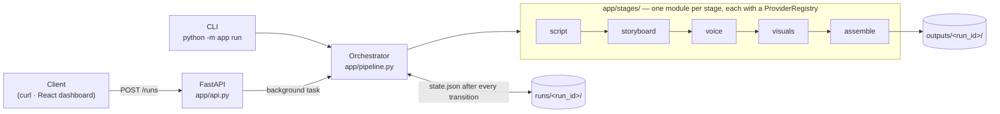

# AI School 369 — Video Pipeline

**Turn a lesson topic into a narrated educational video, one replaceable stage at a time.**

`ai-school-369-video-pipeline` is a FastAPI service that runs a five-stage pipeline
(script → storyboard → voice → visuals → assemble). Each stage is a small module with a
**provider registry**, so swapping an LLM, TTS engine or image model is a config change rather
than a rewrite. Every run keeps its state on disk, which means you can inspect it, and a run that
fails partway through picks up from the stage that failed.

> **Status:** v0.1.0 scaffold. Every stage ships with an offline `mock` provider, so the whole
> pipeline runs end to end without API keys. Real providers are on the [roadmap](#roadmap).

---

## Architecture



| Component | Responsibility |
|---|---|
| `app/stages/base.py` | `Provider` contract, `ProviderRegistry`, `StageContext` |
| `app/stages/<stage>.py` | Stage registry plus its providers, registered with `@registry.register("name")` |
| `app/pipeline.py` | Resolves providers, runs stages in order, persists state, skips completed stages when resuming |
| `app/state.py` | Filesystem run store: `runs/<run_id>/state.json` (atomic writes) plus stage artifacts |
| `app/api.py` | HTTP API (runs execute as FastAPI background tasks) |
| `app/config.py` | `pydantic-settings` config from env / `.env` |

**Data flow.** Each provider receives a `StageContext` that holds the run request, the run
directory and the outputs of every earlier stage (`ctx.artifacts["script"]`, …). It returns a
JSON-serialisable dict, which is saved to `state.json` and passed on to the stages after it.

---

## Quickstart

Requires Python 3.11+.

```bash
git clone https://github.com/shekar369/AISchool-video-generation.git
cd AISchool-video-generation

python -m venv .venv && source .venv/bin/activate   # or: uv venv && source .venv/bin/activate
pip install -e ".[dev]"
cp .env.example .env

# Run once from the CLI
python -m app run "Photosynthesis"
# → run 20261017-112444-cf5213: completed
# → output: outputs/20261017-112444-cf5213/manifest.json

# Or start the API
uvicorn app.api:app --reload
```

Then:

```bash
curl -X POST localhost:8000/runs -H 'content-type: application/json' \
     -d '{"topic": "The water cycle", "audience": "middle school students"}'
curl localhost:8000/runs/<run_id>
```

Interactive API docs live at <http://localhost:8000/docs>.

### API

| Method | Path | Description |
|---|---|---|
| `GET` | `/health` | Liveness and version |
| `GET` | `/stages` | Stages in order, with their registered and default providers |
| `POST` | `/runs` | Create a run and start it in the background (`202`) |
| `GET` | `/runs` | List runs, newest first |
| `GET` | `/runs/{run_id}` | Full run state, including per-stage status, timings, errors and outputs |
| `POST` | `/runs/{run_id}/resume` | Re-run a failed run from the stage that failed |

`POST /runs` body:

```json
{
  "topic": "Photosynthesis",
  "audience": "high school students",
  "duration_minutes": 3,
  "providers": { "voice": "mock" }
}
```

---

## Configuration

All settings come from environment variables or `.env` (see [`.env.example`](.env.example)).
`.env` is git-ignored, so **never commit real keys**.

| Variable | Default | Purpose |
|---|---|---|
| `APP_ENV` | `development` | Environment name |
| `LOG_LEVEL` | `INFO` | Python log level |
| `RUNS_DIR` | `runs` | Per-run state and intermediate artifacts |
| `OUTPUTS_DIR` | `outputs` | Final deliverables |
| `SCRIPT_PROVIDER` … `ASSEMBLE_PROVIDER` | `mock` | Default provider per stage (a request can override it) |
| `ANTHROPIC_API_KEY`, `ELEVENLABS_API_KEY`, `OPENAI_API_KEY` | — | Credentials, read only by the providers that need them |

---

## Stages

| # | Stage | Input | Output | `mock` provider |
|---|---|---|---|---|
| 1 | **script** | topic, audience | titled, sectioned narration (`script.md`) | Fixed four-section template |
| 2 | **storyboard** | script | timed scenes with visual prompts | One scene per section; duration from word count |
| 3 | **voice** | scenes | one audio clip per scene (`audio/*.wav`) | Silent WAVs of the right length |
| 4 | **visuals** | scenes | one image per scene (`visuals/*`) | SVG title cards |
| 5 | **assemble** | audio + visuals | final deliverable in `outputs/<run_id>/` | Timeline `manifest.json` (no encoding yet) |

### Adding a provider

```python
# app/stages/voice.py
@registry.register("elevenlabs")
class ElevenLabsVoiceProvider(Provider):
    def run(self, ctx: StageContext) -> dict[str, Any]:
        key = ctx.settings.elevenlabs_api_key
        ...
        return {"clips": [...]}   # same shape as the mock
```

Then pick it with `VOICE_PROVIDER=elevenlabs`, or per request with `"providers": {"voice": "elevenlabs"}`.
Provider names are checked when a run is created, so a typo returns `422` instead of failing
halfway through the run.

---

## Development

```bash
pytest            # unit and API tests (all offline)
ruff check .      # lint
ruff format .     # format
```

Project layout:

```
app/
  api.py          FastAPI app
  pipeline.py     orchestrator
  state.py        run store
  config.py       settings
  models.py       pydantic models
  stages/         one module per stage + base.py
runs/             per-run state (git-ignored)
outputs/          final videos (git-ignored)
tests/
```

---

## Roadmap

- [x] **v0.1** — Staged scaffold, provider registry, file-backed run state, resume, REST API, CLI
- [ ] **Real providers** — Claude for script and storyboard, ElevenLabs / OpenAI TTS for voice, an image model for visuals
- [ ] **ffmpeg assemble** — Encode MP4 with burned-in subtitles and background music
- [ ] **Quality gates** — Script fact-check and reading-level checks, plus duration targeting from `duration_minutes`
- [ ] **React dashboard** — Create runs, watch stage progress live, preview artifacts, resume failures
- [ ] **Durable execution** — Job queue (e.g. arq / Celery) in place of in-process background tasks; per-stage retries
- [ ] **Storage** — Pluggable artifact store (local / S3 / GCS) and a database for run metadata
- [ ] **Delivery** — Docker image, CI, auth on the API
