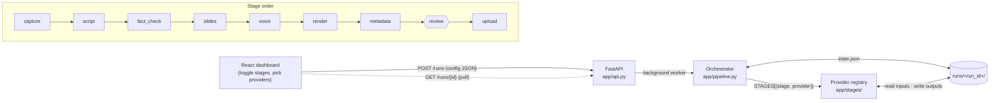

# AI School 369 — Video Pipeline

**From a rough idea to an upload-ready slide video, with one short human review.**

`ai-school-369-video-pipeline` turns a raw idea (rough text or a voice-note transcript) into a
faceless, narrated slide video for the **AI School 369** YouTube channel, which covers AI/ML
training and career guidance. The pipeline drafts everything. The owner checks the result
against a fixed publish-ready checklist in under 30 minutes. Approved videos are uploaded as
**private**, so the owner always publishes by hand.

Design principles:

- **Rough input is fine.** Capture takes seconds, so an idea gets saved before it fades.
- **"Done" is defined, not felt.** The review gate can only be approved once every checklist item is ticked.
- **Polish comes from a template, not editing.** A fixed 1920×1080 slide template plus a natural voiceover. No on-camera footage.
- **Every tool is swappable.** Each stage is one function per provider in a registry. The voice vendor in particular is deliberately left open.

> **Status: v0.1.0 scaffold.** All 9 stages are wired up with offline `stub` providers. A run
> goes end to end, pauses at the review gate and resumes on approval, without API keys or
> ffmpeg. Real providers arrive by milestone; see the [roadmap](#roadmap).

---

## Architecture



- **Registry.** Each stage is a plain function registered under `(stage, provider)`. Adding a tool means one function plus one decorator.
- **Run folder as the contract.** A stage reads the artifacts earlier stages wrote to `runs/<run_id>/` and writes its own. Stages never call each other.
- **Resumable state.** `state.json` is rewritten atomically after every transition. A run that fails can be redone from any stage, and a run cut off by a server restart is marked `error` on startup so it can be redone.
- **Statuses:** `idle` · `running` · `done` · `awaiting_review` · `skipped` · `error`.

| Path | Responsibility |
|---|---|
| `app/stages/base.py` | `STAGES` registry, `@register(stage, provider)`, `StageContext` (run-folder I/O helpers) |
| `app/stages/<stage>.py` | One module per stage, holding its provider functions |
| `app/pipeline.py` | Plans a run from its config, executes stages, handles the review gate, request changes and redo |
| `app/state.py` | Run store (`runs/<run_id>/state.json`) |
| `app/api.py` | HTTP API for the dashboard |
| `app/__main__.py` | CLI for running without the API |

---

## Quickstart

Requires Python 3.11+.

```bash
git clone https://github.com/shekar369/AISchool-video-generation.git
cd AISchool-video-generation
python -m venv .venv && source .venv/bin/activate
pip install -e ".[dev]"
cp .env.example .env
```

**CLI:**

```bash
python -m app run --title "What is RAG?" \
  --idea "RAG grounds LLM answers in your own docs. Retrieve first, then generate." \
  --stages script=stub fact_check=stub slides=stub voice=stub render=stub metadata=stub upload=stub
# run 20261017-115135-ade1bc: awaiting_review

python -m app approve 20261017-115135-ade1bc --all
# run 20261017-115135-ade1bc: done
```

**API:**

```bash
uvicorn app.api:app --reload        # docs at http://localhost:8000/docs

curl -X POST localhost:8000/runs -H 'content-type: application/json' -d '{
  "title": "What is RAG?",
  "idea": "RAG grounds LLM answers in your own docs.",
  "stages": [
    {"stage": "script", "provider": "stub"},
    {"stage": "slides", "provider": "stub"},
    {"stage": "voice",  "provider": "stub"},
    {"stage": "render", "provider": "stub"}
  ]
}'
```

---

## Run config

The dashboard sends one JSON document per run. Stages it lists run in canonical order,
whatever order they're listed in. Stages it leaves out are `skipped`. `capture` and `review`
always run.

```json
{
  "channel": "AI School 369",
  "title": "Working title",
  "idea": "raw idea text",
  "stages": [
    {"stage": "script", "provider": "stub"},
    {"stage": "slides", "provider": "stub"},
    {"stage": "voice",  "provider": "stub"},
    {"stage": "render", "provider": "stub"}
  ]
}
```

Unknown stages, unknown providers and duplicate stages are rejected with `422` when the run is
created, before any work starts.

## API

| Method | Path | Description |
|---|---|---|
| `POST` | `/runs` | Create a run and start it in the background (`202`) |
| `GET` | `/runs` | List runs, newest first |
| `GET` | `/runs/{id}` | Full run state: run status, per-stage status, timings, errors, review history (the dashboard polls this) |
| `POST` | `/runs/{id}/approve` | Body `{"checklist": {...}}`. Every item must be `true`, otherwise `422` lists the missing items |
| `POST` | `/runs/{id}/changes` | Body `{"notes": "...", "redo_from": "script"}`. Records the notes and redoes from that stage (must come before review) |
| `POST` | `/runs/{id}/redo?from=<stage>` | Reset that stage and all later ones to `idle` and re-run |
| `GET` | `/stages` | Stages in order, with their registered providers and whether they're required |
| `GET` | `/review/checklist` | Checklist keys and labels for the review UI |
| `GET` | `/health` | Liveness and version |

Actions that don't fit the run's current state, such as approving a run that isn't waiting for
review or redoing a run that's still running, return `409`.

---

## Stages

| # | Stage | Writes | Planned providers | v0.1 provider |
|---|---|---|---|---|
| 1 | **capture** | `capture.json` | text, voice-note transcript | `text` |
| 2 | **script** | `script.json` (one entry per slide, with narration) | Claude API, local model | `stub`: one slide per sentence |
| 3 | **fact_check** | `fact_check.json` (claims checked, items flagged) | Claude API | `stub`: checks nothing and says so |
| 4 | **slides** | `slides/NN.png` (1920×1080) | Marp → PNG, HTML + Playwright | `stub`: blank frame of the right size |
| 5 | **voice** | `audio/NN.wav` | cloned own voice (with consent), stock voice, local draft voice | `stub`: silence timed to the narration |
| 6 | **render** | `video.mp4` (fades, burned-in captions) | ffmpeg, MoviePy | `stub`: `timeline.json` only, no video |
| 7 | **metadata** | `metadata.json` (title, description, chapters, tags, thumbnail text) | LLM draft, manual | `stub`: built from the script and timeline |
| 8 | **review** | `review.json` | human gate | `checklist` |
| 9 | **upload** | `upload.json` | YouTube Data API (**private**), export files only | `stub`: records intent, never uploads |

### Review checklist

Every item is required before a run can be approved:

- [ ] Hook lands in the first 15 seconds
- [ ] Facts and code are correct
- [ ] Voice sounds natural, technical terms pronounced correctly
- [ ] Slides readable on a phone
- [ ] Title and thumbnail match the content
- [ ] It would genuinely help one learner

### Adding a provider

```python
# app/stages/voice.py
@register("voice", "cloned")
def voice_cloned(ctx: StageContext) -> None:
    script = ctx.read_json("script.json")
    for slide in script["slides"]:
        ...  # synthesise, then write ctx.path("audio", f"{slide['index']:02d}.wav")
```

It shows up in `GET /stages` straight away, and a run can select it with
`{"stage": "voice", "provider": "cloned"}`.

---

## Configuration

Settings are read from environment variables or `.env` (see [`.env.example`](.env.example)).
`.env` is git-ignored. **Never commit secrets.**

| Variable | Default | Used by |
|---|---|---|
| `APP_ENV` | `development` | — |
| `LOG_LEVEL` | `INFO` | logging |
| `RUNS_DIR` | `runs` | run store |
| `ANTHROPIC_API_KEY` | — | Claude providers (v0.2) |
| `YOUTUBE_CLIENT_ID` / `YOUTUBE_CLIENT_SECRET` / `YOUTUBE_REFRESH_TOKEN` | — | YouTube upload (v0.5). Authorize against the AI School 369 channel account |

Voice-provider settings will be added once the v0.3 voice comparison picks a vendor.

---

## Development

```bash
pytest           # offline: no keys, no ffmpeg
ruff check .
ruff format .
```

Project context, constraints and conventions live in [`CLAUDE.md`](CLAUDE.md).
Commits follow [Conventional Commits](https://www.conventionalcommits.org/), and milestones are tagged.

---

## Roadmap

- [x] **v0.1.0 — Scaffold:** registry, state file, stub stages, API skeleton, review gate, redo
- [ ] **v0.2.0 — Script, fact_check, slides:** Claude script and fact check, fixed Marp/HTML slide template
- [ ] **v0.3.0 — Voice and render:** voice provider comparison first, then ffmpeg render with fades and captions
- [ ] **v0.4.0 — Metadata, review and dashboard:** LLM metadata drafts, React dashboard wired to the API
- [ ] **v0.5.0 — Upload:** YouTube Data API upload as private

Out of scope: on-camera video, stock footage, copying other channels' style, viral-style
subtitle effects, automatic public publishing.

---

## Acknowledgements

Some ideas were inspired by two open-source projects. From **yt-video-factory** (MIT): a stage
CLI, resumable run state and private-draft upload. From **edu-shorts** (GPLv3): a
rebuild-from-edited-script loop and a research step. This codebase is written from scratch and
contains no code from either project.

## License

No license has been chosen yet. Until a `LICENSE` file is added, all rights are reserved.
